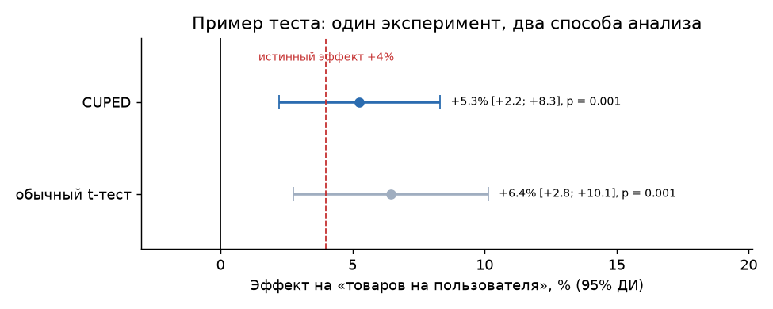
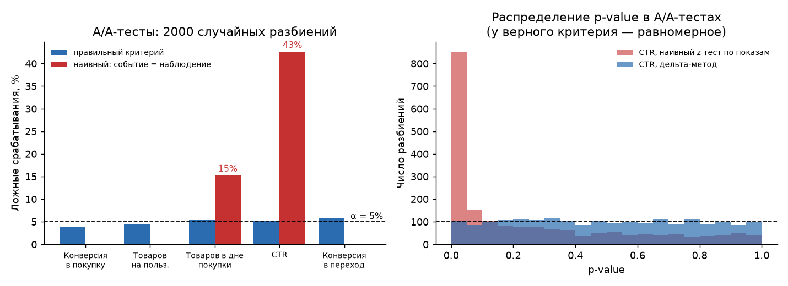
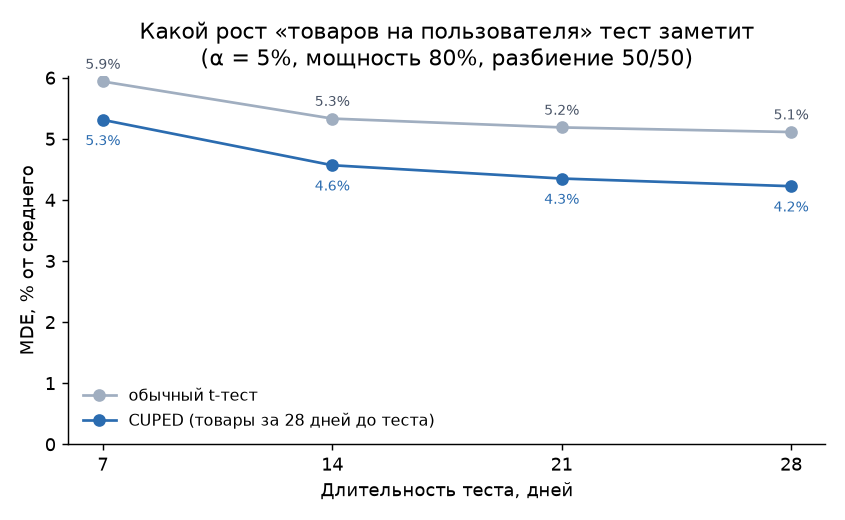
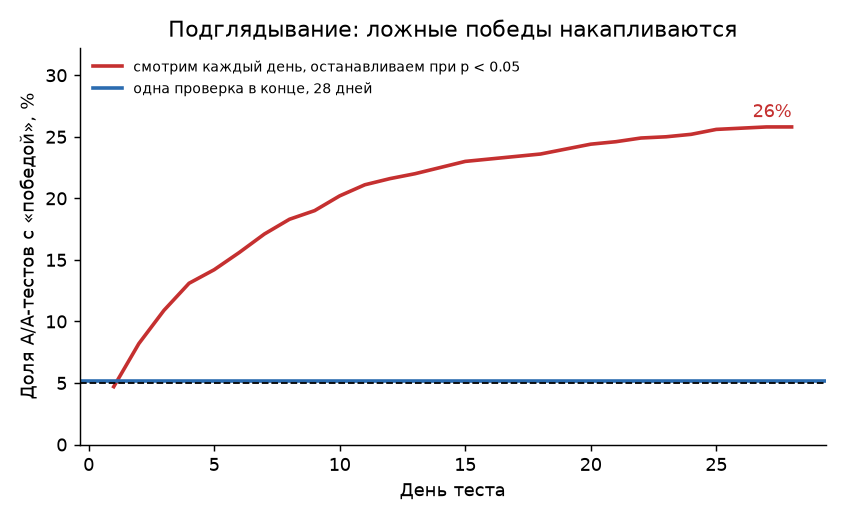

# Методика A/B-тестов на данных экосистемы Т-Банка

Как проводить A/B-тесты в продуктовой экосистеме, чтобы находить небольшие эффекты и не принимать шум за успех. Методика проверена на реальных обезличенных логах [T-ECD](https://huggingface.co/datasets/t-tech/T-ECD): 37 тыс. пользователей ритейла и 625 тыс. пользователей маркетплейса за 28 дней. Предыдущие 28 дней служат историей для CUPED.

Рандомизированного эксперимента в открытых данных нет, поэтому методика проверяется так же, как в командах A/B-платформ: на исторических данных. Пользователей тысячи раз случайно делят на две группы без всякого воздействия (A/A-тест), а для проверки мощности в тестовую группу добавляется эффект известного размера.

Стек: DuckDB (агрегация 400 млн событий), Python (NumPy, SciPy, pandas), matplotlib.

## Главное

| Вопрос | Ответ |
|---|---|
| Можно ли считать CTR z-тестом по показам? | **Нет.** В 2000 A/A-тестах он находит несуществующий эффект в **40%** случаев вместо 5%: показы одного пользователя не независимы. Дельта-метод даёт 4,6%. Для «товаров в дне покупки» — 16% против 5,5% |
| Какой эффект тест заметит за 28 дней? | «Товаров на пользователя» — от **5,1%**, конверсию в покупку — от 2,8%, CTR — от 2,1% (α = 5%, мощность 80%, разбиение 50/50) |
| Сколько даёт CUPED? | Снижает дисперсию «товаров на пользователя» на **32%**, MDE — с 5,1% до 4,2%. Это равносильно росту выборки в 1,5 раза. Для CTR и конверсии в переход — только 2%: прошлые клики слабо предсказывают будущие |
| Как часто CUPED ловит эффект +4%? | В **73%** запусков против 57% у обычного t-теста (1000 симуляций) |
| Что будет, если смотреть результат каждый день? | Ложная «победа» в **24%** A/A-тестов. Еженедельные проверки при p < 0,05 — 12%. Порог Покока 0,0182 на 4 проверки возвращает ошибку к **5,0%** |
| Что делать с пятью метриками? | Вероятность хотя бы одного ложного срабатывания — **21,5%**. Поправка Холма снижает её до 4%, оставляя больше мощности, чем Бонферрони |
| Ловит ли проверка SRM потерю пользователей? | Если в тестовой группе теряются события 2,4% пользователей, χ² не видит перекоса (p = 0,07), и это граница чувствительности. При потере 4,8% p < 0,001, и проверка спасает от ложного роста конверсии на 1,8 п.п. (p < 0,001) |

## Правила для команды

1. **Единица анализа — единица рандомизации.** Делим пользователей — значит, и дисперсию считаем по пользователям. Для отношений (CTR, средний чек, товаров в заказе) — дельта-метод или линеаризация, а не тест по событиям.
2. **Длительность и MDE — до запуска.** Если ожидаемый эффект меньше MDE, тест не нужен в таком виде: надо брать более чувствительную метрику, CUPED или больше трафика.
3. **CUPED — по умолчанию для метрик объёма.** Ковариата — та же метрика за период до теста. Для редких событий выигрыш небольшой, проверять на исторических данных.
4. **Результат смотрим один раз**, в запланированный день. Если нужны промежуточные проверки, их число и порог фиксируются заранее (Покок, О'Брайен — Флеминг).
5. **Одна главная метрика**, остальные — с поправкой Холма или как контрольные (guardrail).
6. **SRM проверяется до чтения метрик**, порог p < 0,001. При перекосе результат не интерпретируется, ищется причина: потеря событий, боты, ошибка разбиения.

## Пример теста

Изменение увеличивает число купленных товаров на 4%. Эффект внесён в тестовую группу случайного разбиения, конверсия в покупку не меняется.



| Шаг | Результат |
|---|---|
| SRM | 18 764 против 18 628, p = 0,48 — разбиение в порядке |
| Главная метрика, обычный t-тест | +3,9%, 95% ДИ [+0,3%; +7,6%], p = 0,035 |
| Главная метрика, CUPED | +3,6%, 95% ДИ [+0,6%; +6,6%], p = 0,020 — интервал уже на 17% |
| Контрольная метрика: конверсия в покупку | без изменений, p > 0,99 |
| Решение | выкатывать: эффект значим, контрольная метрика не просела |

В этом запуске значимы оба метода. Но по 1000 симуляций обычный t-тест находит такой эффект только в 57% случаев, а CUPED — в 73%.

## Графики







## Данные и метрики

[T-ECD](https://huggingface.co/datasets/t-tech/T-ECD) — датасет Т-Банка (KDD 2026): действия пользователей в доменах экосистемы. Использована версия `small`, домены «ритейл» и «маркетплейс», дни 1253–1308.

| Метрика | Домен | Тип | Значение |
|---|---|---|---|
| Конверсия в покупку | ритейл | доля пользователей | 51,8% |
| Товаров на пользователя | ритейл | среднее, тяжёлый хвост (99-й перцентиль — 265) | 32,3 |
| Товаров в дне покупки | ритейл | отношение | 18,0 |
| CTR | маркетплейс | отношение | 2,45% |
| Конверсия в переход к партнёру | маркетплейс | доля пользователей | 3,7% |

В тест попадает каждый, кто хоть раз зашёл в сервис за 28 дней теста, — как пользователи, которые увидели изменение. Цен в событиях нет, поэтому денежные метрики заменены товарными.

## Как устроен проект

```
data/download.sh   загрузка нужных файлов T-ECD (~3 ГБ) с докачкой
src/build.py       DuckDB: события → таблицы пользователей и дней
src/abtools.py     критерии: t-тест, z-тест долей, дельта-метод, CUPED, MDE, SRM, Холм
src/analysis.py    A/A-тесты, мощность, подглядывание, SRM, пример теста → reports/
run.sh             весь прогон одной командой
```

A/A-тесты векторизованы: суммы по группам для тысяч разбиений считаются одним матричным умножением, поэтому 2000 разбиений по 625 тыс. пользователей занимают секунды.

## Запуск

```bash
sh data/download.sh
./run.sh
```

Нужен Python 3.11+. Зависимости ставятся в `.venv` автоматически.

## Ограничения

- **Данные обезличены с шумом**: время событий смещено, часть событий удалена или добавлена. На оценку дисперсии и ложных срабатываний это почти не влияет, но абсолютные значения метрик не равны реальным показателям Т-Банка.
- **Эффект в примере внесён искусственно** и одинаково для всех пользователей. Реальные эффекты неоднородны, и CUPED может работать на них иначе.
- Порог Покока и поправка Холма — простые решения. В продакшене чаще используют функции расходования ошибки (alpha spending) или последовательные тесты (mSPRT).

---
Данные: T-ECD, © T-Bank, лицензия CC BY-NC-SA 4.0; в репозиторий не включены. Liakhnovich K. et al. T-ECD: A Large-Scale Cross-Domain E-Commerce Dataset for Industrial Recommender Systems. KDD 2026.

Автор — Никита Джахнаев, Telegram [@snnvw](https://t.me/snnvw). Учебно-портфолио проект, 2026.
